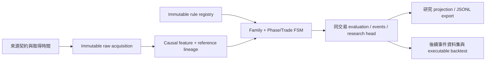

# V3.3 P0–P4 工程交付報告

日期：2026-10-30。**工程骨架已交付；模型仍為 PRE_VALIDATION，沒有 live trading approval。** 本報告的 P0–P4 是使用者本輪貼文的任務編號，不是主規格第 45 節的研究路線 P0–P10；沒有執行 feature ablation 或模型校準。

完整閱讀並保留原始主規格於 [00_master_spec.md](00_master_spec.md)，來源檔案 SHA-256：`d752067598d3cc6a91cc40dc8ede506f8d55658f43be2ba182e3461fae8a44b5`。任務中的「Contract Rules／Model Hypotheses」區分優先於文件中自稱已驗證的文字。

## 1. 架構變更與範圍

| 本輪項目 | 交付 | 邊界 |
|---|---|---|
| P0 Contract Skeleton | Rule registry、版本／hash、namespace/run、idempotent evaluation | 所有附帶規則 EXPERIMENTAL；無 Champion |
| P1 Data Contract | Source catalog、auth/retention/update/timestamp/missing metadata、顯式 ms/us、raw provenance | 不代表所有 collector 已連接 |
| P2 Continuous Archive 設計 | 分批採集、cursor、gap/revision、checksum、容量與儲存設計 | 沒有啟用五分鐘全市場 archive 或建立新服務 |
| P3 Causal Feature Store | 不可變 feature、lineage、available-asof query、past-only references、修訂重播 | 不發明尚未定義的 feature／quality 公式 |
| P4 FSM + Journal + Properties | 雙 FSM、Family/breadth、Gate、parent chain、原子結果、矩陣／生成測試 | 不取代 V2 正式判定，不直接交易 |

沿用現有 ResearchJournal 交易、SQLite/PG、immutable csr_records 與測試服務；沒有新 scanner、第二套 cron 或新帳號。PR #19 的 demand 排程仍為獨立變更，不重做、不合併進本分支。修改前盤點見 [repository-audit.md](repository-audit.md)。

## 2. 新增／修改檔案

- `src/v33/contracts.py`：時間、資料／特徵契約、hash、namespace、evaluation identity。
- `src/v33/registry.py`、`experimental.json`：immutable rule versions、EXPERIMENTAL policy、完整 registry metadata、參數基本檢查；不自動 promotion。
- `src/v33/sources.py`、`causal.py`：來源契約、已封閉時間、單位、past-only percentile。
- `src/v33/families.py`：FamilyScore／Coverage／Status／Strong、DistributionScore、ScoreBreadth。
- `src/v33/fsm.py`：Phase、Trade、Gate、confirmation、TTL、parent events。
- `src/v33/journal.py`：沿用 journal backend 的 V3 transactions、資料／feature／evaluation／event 保存、修訂與鎖定。
- `src/v33/presentation.py`、`__init__.py`：最小研究 projection／模組邊界；正式 Dashboard 不改。
- `schema/v33_contract.sql`：加法 migration；正式 Neon 尚未套用。
- `tools/v33_research.py`：離線 SQLite init／來源清單／JSONL replay，沒有 PRODUCTION 選項、沒有幣安或發布呼叫。
- `tests/test_v33_contracts.py`、`test_v33_cli.py`：生成式、矩陣、因果、修訂、Gate、CLI byte-stable 重播及檔案覆寫保護。
- `tests/test_storage_services.py`：沿用原服務 fixture，新增真正 PG 的 V3 concurrency、FK event append、role／trigger／namespace 驗證。
- `requirements-dev.txt`、CI、ignore files：Hypothesis 固定 dev dependency；不加入正式 requirements 或部署測試資料。
- `docs/v33/00–07` 與盤點文件：原規格、canonical owners、設計、實作界線與驗收紀錄。

原本 `run_cycle.py`、V2 engine／lifecycle、API、Dashboard、Vercel 配置與正式排程均未改動。

## 3. Database schema

| 儲存 | 用途 | 寫入限制 |
|---|---|---|
| 原 `csr_records` | `v33:registry:rules`；scope-specific raw acquisition | 沿用 immutable trigger／SELECT+INSERT |
| `csr_v33_features` | feature payload／lineage／版本／availability index | append-only，namespace/run/feature_id PK |
| `csr_v33_evaluations` | immutable result、input hash、evaluation key/id、snapshot hash、supersedes | append-only；namespace/run/key PK；evaluation_id UNIQUE |
| `csr_v33_events` | phase/trade event、chain、parent、sequence | append-only；FK 到 evaluation；scope/key/type/sequence UNIQUE |
| `csr_v33_heads` | 每個 namespace/run/symbol/rule 的研究投影／revision | 唯一可更新的 V3 runtime projection |

SQLite explicit init 與 PG explicit migration 共用 portable DDL；PG/SQLite 都有 immutability trigger。PG migration rerun 已驗證；應使用 migration role，runtime 僅 SELECT/INSERT history 與必要 head columns UPDATE，不授予 DELETE／DDL。正式環境未 migration、未連接新 namespace。

## 4. Data flow



所有 feature availability ≤ evaluation time；normalization references 必須嚴格早於 asof，不能省略必要 reference lineage。sources dedup 後一次讀取，不在交易中發網路請求。PG 評估鎖自己的 research head，不鎖正式 scanner runtime。相同輸入回傳原結果與原 revision，CLI 以固定排序輸出相同 bytes。

## 5. State machine implementation

Phase 七態與 trade 六態分離。Market phase 逐邊推進；Trade 可以同輪按序 SETUP→READY→TRIGGERED。durable parent 驗證包含 namespace/run/symbol/rule/chain/時間；沒有 READY 不能產生 TRIGGERED。pump anchor 為真正 NORMAL→PUMP 的 evaluation time。

三個 VALID 可算分；PARTIAL 高分也不算 Strong。成熟標的 REDUCED 不會新進 READY；New Listing exception 參數化且仍 EXPERIMENTAL。已有 READY 失去 breadth qualification 會新增 INVALIDATED。

Gate authoritative source 只有 ActiveBlocks；Squeeze hysteresis 以不同 observation 計數；固定 setup TTL 不刷新；同 chain terminal 互斥且 absorbing。詳見 [03_state_machine.md](03_state_machine.md)，其中明列必要的規格解讀。

## 6. 測試結果

- 本機完整 suite：**240 passed，4 opt-in storage skipped**；V3.3 專屬案例包含 127 組完整矩陣：49 phase edges、36 trade edges、42 coupling。
- 三組 Hypothesis property tests 配置最多 300 組輸入，涵蓋 Family 缺值／coverage、時間序列、parent／Gate／terminal、資料可得時間與同輸入去重；不是策略回測或成功率。
- 真正 PostgreSQL／Redis：**4 passed**。沿用三項既有 storage cases，新增一項 V3 PG case，驗證 additive migration 可重跑、並行相同 evaluation 只寫一筆、feature／evaluation／event 不可更新、namespace 隔離及 V2 revision 不動。測試容器已清除。
- 離線 CLI 執行兩次輸出一致且 evaluation 只有一筆；拒絕把輸出覆寫到 journal。沒有額外全市場掃描、沒有 Binance 請求。
- PG 證據：忽略版控的 `artifacts/verification/v33-storage-services.json`。最終遠端 CI 以本 PR checks 為準；沒有以舊版測試數冒充新模型有效。

## 7. 尚未完成的資料來源／元件

V3 ingestion 尚未接入正式 collector：OI quantity/notional 雙欄 archive、Taker、Top Trader Account/Position、Global accounts、Mark/Index/premium 原始保存、Funding 增量 archive、Spot/Perp aggTrades cursor／gap repair／CVD。

Smart Signal 無已確認穩定公開 Developer API，保持 optional；Top Trader Account/Position 需只讀 API key。大型 raw archive backend、儲存容量與成本尚未選定。現有 V2 raw/features 不會自動被宣告具有 V3 point-in-time 可得性。

Efficiency／OI deceleration／結構／CVD／品質／Squeeze／Maturity producers 亦未提供已驗證公式。本輪可以重播外部有版本與 lineage 的研究 features，不宣稱已完成真實 V3 掃描模型。正式 Dashboard 尚未接 V3；提供的 research projection 不是上線介面。

## 8. 下一階段研究建議

先完成可量測、受資源限制的資料保存與 QA，再研究 OI deceleration、Price/OI Efficiency、Spot/Perp CVD divergence 的 out-of-sample 增益。之後才做 Pump Event Dataset、含成本和 stop-first 的 executable backtest、purged nested walk-forward、ablation 與 Champion/Challenger。方法及邊界見 04／05／06 文件。

本輪依要求停在 P0–P4，未自行進行大量模型優化、threshold tuning、grid search 或 production promotion。

## 9. 與 V3.3 的差異／未定義處

1. I9 需排除已終結狀態，否則與 I13／歷史保存矛盾。本輪保留 terminal，不抹成 WATCH。
2. Executable 的指定公式不包含 trade state，WATCH 也可能 Gate OPEN。本輪保留公式，但另給 signal_eligible；不能把 Gate 通過當作可下單。
3. 缺少完整 phase recovery、MARKDOWN reset、新 setup/cooldown、invalidation、TTL 起點。本輪保守封閉 chain，以新研究 run 啟動獨立樣本，未自創 live cycle 政策。
4. Reference TTL 數值及 SETUP 起點是明確記錄的 EXPERIMENTAL bootstrap，並非主規格已給定或驗證。
5. Reduced breadth 在既有較後 phase 退化時沒有合法反向 edge。本輪凍結已觀察 phase、不再推進，必要時終結 trade qualification，沒有偽造倒退轉移。
6. 新幣 I11 按章節標題解讀為 **Reduced-Breadth exception**；FULL 新幣不把此例外當成全面必要條件。
7. Component／Quality／Squeeze 等缺精確公式，不將文中的名字當成已完成演算法。外部 producer 尚未補齊就是缺資料。
8. Top Trader Position 是比例，不是絕對 Long notional；Global account ratio 不是可識別的散戶持倉。因此 reference component 名稱使用 share/account，而不宣稱大戶實際撤倉。
9. availability 歷史通常沒有完整原始發布證據。使用原始成交時間回填 availability 會洩漏或過度樂觀，本輪明確保留 observed／assumed 差異。

## 10. 結論與停止點

已建立可以保存、追蹤、重播並驗證 V3.3 工程契約的隔離基礎。**尚未完成也未宣稱 V3.3 交易模型已驗證、資料已持續全量蒐集、正式訊號已切換或回測可實際成交。** 正式版本及 24 小時排程基準保留；本輪變更以獨立 PR 審查，不與 PR #19 重複部署。

使用方式：

```powershell
.venv/Scripts/python.exe tools/v33_research.py sources
.venv/Scripts/python.exe tools/v33_research.py init --journal data/v33/research.sqlite3
.venv/Scripts/python.exe tools/v33_research.py replay --journal data/v33/research.sqlite3 --namespace REPLAY --run-id example --frames <causal-frames.jsonl> --output artifacts/v33/example.jsonl
.venv/Scripts/python.exe -m pytest -q
```

每個 frame 提供 symbol、evaluation_time、observations、features。observation 可用 alias；feature 的 source_aliases 會解析為實際 raw record_id，或直接提供 source_ids。每次修訂另開 run，並提供 supersedes_evaluation_id；不能以晚到資料倒寫已完成的 evaluation。
